<p align="center">
  <picture>
    <source media="(prefers-color-scheme: dark)" srcset="docs/assets/hero-dark.svg">
    
  </picture>
</p>

<p align="center">
  <a href="https://github.com/IvanMurzak/Code-Exec/actions/workflows/ci.yml"></a>
  <a href="https://www.nuget.org/packages/com.IvanMurzak.CodeExec"></a>
  <a href="https://www.nuget.org/packages/com.IvanMurzak.CodeExec.Roslyn"></a>
  <a href="LICENSE.md"></a>
  <a href="https://ai-game.dev"></a>
</p>

<p align="center">
  <b>Run short code snippets inside a live host process</b> (game engines, editors, any .NET or Python host)<br>
  with <b>one contract</b> for <b>C#</b> and <b>Python</b>. Built for AI agents: the agent writes only the statements it
  needs,<br>the result comes back as text, and errors point at the agent's own lines.
</p>

<p align="center">
  <a href="spec/contract.md"><b>Contract</b></a> ·
  <a href="fixtures/golden">Golden cases</a> ·
  <a href="https://www.nuget.org/packages/com.IvanMurzak.CodeExec">NuGet</a>
</p>

## Contents

- [Why Code-Exec](#why-code-exec)
- [How a snippet runs](#how-a-snippet-runs)
- [Quick start](#quick-start)
- [Snippets at a glance](#snippets-at-a-glance)
- [Execution guards](#execution-guards)
- [Runtimes](#runtimes)
- [Build and test](#build-and-test)
- [Documentation](#documentation)
- [License](#license)

## Why Code-Exec

An agent that works on a running game or editor often needs one small piece of code: read a value, try an API, fix
an object. Code-Exec runs that piece inside the host, next to the live objects, and answers in a shape an agent can
read:

```csharp
using System.Text;                 // optional: own usings, aliases, `using static`
var sb = new StringBuilder("ab");
class Helper { public static int Twice(int v) => v * 2; }   // types and functions are allowed
sb.Append(Helper.Twice(21));
sb.ToString()                      // last expression = the result → "ab42"
```

```text
success  true      value  ab42      autoImported  System.Text      compileMs 609 · executeMs 2
```

- **Statements, not boilerplate.** No class, no `Main`: usings, types and functions where the agent needs them, and
  the last expression is the result. Unknown simple names are imported when exactly one namespace defines them.
- **Errors in the agent's coordinates.** Diagnostics and stack frames name `snippet.cs` / `snippet.py` and the
  agent's own lines, never the generated wrapper:
  `snippet.cs(2,3): error CS1061: 'int' does not contain a definition for 'Lenght'`.
- **Safe for the host.** Runaway recursion and endless loops stop the run with an error, never the process, also on
  the host's main thread ([details](#execution-guards)).
- **Any Roslyn, no dependency.** The core has no package dependencies; the Roslyn adapter ships as **source** and
  compiles against the Roslyn your host already has (3.8 or newer).
- **One contract, two runtimes.** C# and Python share one request/response shape and one set of golden cases
  ([`spec/contract.md`](spec/contract.md), [`fixtures/golden/`](fixtures/golden)).

## How a snippet runs

<p align="center">
  <picture>
    <source media="(prefers-color-scheme: dark)" srcset="docs/assets/flow-dark.svg">
    
  </picture>
</p>

`Prepare()` wraps the statements, resolves names, injects the guards and compiles against the assemblies the host
already runs; it is safe on a background thread. `Run()` / `RunAsync()` invoke the snippet on the calling (main)
thread. On CoreCLR each run gets its own collectible `AssemblyLoadContext`; on Mono identical requests reuse one
assembly. The host's `ValueConverter` turns the result into something that outlives the snippet before its code is
released (Unity: ReflectorNet JSON).

## Quick start

### C# (NuGet)

```xml
<PackageReference Include="com.IvanMurzak.CodeExec" Version="0.4.0" />
<PackageReference Include="com.IvanMurzak.CodeExec.Roslyn" Version="0.4.0" />
<PackageReference Include="Microsoft.CodeAnalysis.CSharp" Version="4.8.0" />  <!-- your choice, 3.8+ -->
```

```csharp
var runner = new CodeRunner(new RoslynCSharpCompiler(), new CodeRunnerOptions
{
    DefaultUsings = new[] { "System", "System.Linq", "UnityEngine" },   // the host's defaults
    IncludeRoot = ".ai-game-dev/snippets",                              // where `include` paths resolve
});
ExecuteResult result = await runner.ExecuteAsync(new ExecuteRequest { Code = "Application.unityVersion" });
```

`com.IvanMurzak.CodeExec` targets `netstandard2.0` (Unity / Mono, .NET Framework) and `net8.0`.
`com.IvanMurzak.CodeExec.Roslyn` is source-only: it compiles inside your project against **your**
`Microsoft.CodeAnalysis.CSharp`.

### Python

```python
import code_exec
code_exec.run("x = 21\nx * 2", include=["helpers"], include_root=".ai-game-dev/snippets", imports=["unreal"])
code_exec.run_b64(base64_json_request)                # JSON in, JSON out: one string literal from C++
code_exec.run("print('x')", max_log_chars=0)          # the same limits as C# (JSON: maxLogChars, ...); 0 = no limit
code_exec.run("while True: pass", timeout_ms=5000)    # stopped by a watchdog: errorKind Timeout (JSON: timeoutMs)
code_exec.set_default_timeout_ms(30000)               # the budget of requests without one (default 120000; 0 = none)
code_exec.set_max_timeout_ms(280000)                  # the most a request may ask for (default 0 = no cap)
code_exec.set_max_recursion_limit(3000)               # Python < 3.12: the most a snippet's sys.setrecursionlimit sets (0 = no cap)
```

The `code_exec` package uses the standard library only (Python 3.10+); hosts vendor it.

## Snippets at a glance

```python
import math
x = 21
math.floor(x * 2.5)                # last expression = the result → "52"
```

| | |
|---|---|
| Result | the last expression (C# and Python), or `return` (C#); `returnType` names its static type |
| Logs | `Console` / `print` / engine log hooks, as `{ level, message }` entries |
| `include` | files and folders (recursive): the agent's helper "micro-projects", compiled or loaded with the snippet; they stay inside the include root unless the host allows otherwise |
| Auto-import | unknown simple names are imported when exactly one namespace defines them (`autoImported`); ambiguous names are reported, never guessed; CoreLib's `Internal.*` namespaces are never imported |
| Full-source mode | C#: `entry: { type, method }` compiles the code verbatim and invokes that method |
| Parameters | C#: `{ name, type, value }` arguments with host types and already-deserialized values |
| Output limits | value, logs (first and last lines kept, 2k per line) and error: 20k characters each by default; `0` = no limit ([§6](spec/contract.md#6-output-limits)) |
| Error kinds | `None`, `InvalidRequest`, `Compile`, `EntryPointNotFound`, `Runtime`, `Timeout`, `NotAvailable` |

Hosts that load assemblies from memory (Godot's game assembly) pass a `locationResolver` to
`LoadedAssembliesReferenceProvider`, otherwise snippets cannot see those types. On CoreCLR a snippet binds to the copy
the process already runs (any load context) before the default context is asked, so a host's
`AssemblyLoadContext.Default.Resolving` handler cannot hand it a second copy.

## Execution guards

.NET cannot catch a stack overflow, and code on the host's main thread cannot be aborted from outside. So the C#
runtime compiles guards into the agent's code ([§3.6](spec/contract.md#36-execution-guards)); Python uses a watchdog.

| Guard | What happens |
|---|---|
| Recursion | stops with `System.InsufficientExecutionStackException: Recursion too deep` before a stack overflow could end the host; allowance `MaxStackBytes` (1 MiB) |
| Time | loops, calls and blocking waits (`Join`, `Wait`, `Result`, `Sleep`, ...) check the clock; once the budget is spent the run stops with `Timeout`, also in synchronous code on the main thread |
| Threads and tasks | work the snippet starts (`new Thread`, `ThreadPool`, `Task.Run`, `StartNew`) belongs to its run and stops once the run has ended |
| Catch-alls | the agent's `catch (Exception)` lets a stop pass, so it reaches the runtime; `finally` blocks still run |

Budget: `TimeoutMs` on the request, else `DefaultTimeoutMs` (120 s), at most `MaxTimeoutMs` (0 = no cap);
`ExecutionGuards = false` turns the guards off. For agent tools: expose `timeoutMs` as a `timeout` argument, default
to about 30 s, and cap it below the tool's own timeout ([§1](spec/contract.md#1-request)).

## Runtimes

<p align="center">
  <picture>
    <source media="(prefers-color-scheme: dark)" srcset="docs/assets/architecture-dark.svg">
    
  </picture>
</p>

| | C# (`dotnet/`) | Python (`python/`) |
|---|---|---|
| Hosts | Unity (Mono), Godot (.NET 8+), BRUTAL, any .NET Framework / .NET app | Unreal Editor (PythonScriptPlugin), any embedded interpreter |
| Ships as | NuGet `com.IvanMurzak.CodeExec` + source-only `com.IvanMurzak.CodeExec.Roslyn` | the `code_exec` package, vendored by the host |
| Dependencies | **none**: you bring your own `Microsoft.CodeAnalysis.CSharp` (3.8 or newer) | standard library only, Python 3.10+ |
| Unloading | CoreCLR: each run in its own collectible `AssemblyLoadContext`; Mono: identical requests reuse one assembly | fresh namespace per run |
| Guards | compiled into the snippet: stack, time, blocking waits, threads and tasks | watchdog for the time budget, capped recursion limit |
| Golden cases | [`fixtures/golden/csharp.json`](fixtures/golden/csharp.json) | [`fixtures/golden/python.json`](fixtures/golden/python.json) |

**Why no Roslyn dependency.** Every host already has its own Roslyn constraints (Unity pins 4.8 because of
`System.Collections.Immutable`; Godot and .NET 10 apps can use the latest). So the core library has no dependencies
at all, and the Roslyn adapter ships as source: it compiles inside your project, against your Roslyn. CI checks that
source against Roslyn 3.8, 4.0, 4.8, 4.14 and 5.x, on .NET Framework 4.8, .NET 8 and .NET 10.

Code-Exec powers the code execution tools of [AI Game Dev](https://ai-game.dev) for Unity, Unreal Engine and Godot.
The library itself has no dependency on any engine, MCP or hosted service.

## Build and test

Requirements: .NET SDK 10 (and the .NET 8 runtime), Python ≥ 3.10.

```bash
scripts/test-all.sh                                  # .NET tests, pack + package consumer, Python tests
ROSLYN_VERSIONS="3.8.0 4.8.0 5.9.0" scripts/test-all.sh
dotnet test dotnet/CodeExec.Tests -p:RoslynVersion=4.8.0
dotnet test dotnet/CodeExec.Tests -p:IncludeNetFx=true -f net48   # Windows: the Mono-like path
python -B -m unittest discover -s python/tests
scripts/pack.sh                                      # pack + package shape checks, publishes nothing
python3 scripts/readme-assets.py                     # regenerate the README art in docs/assets/
```

Releases: [`.github/workflows/release.yml`](.github/workflows/release.yml), dispatch only.

## Documentation

| | |
|---|---|
| [`spec/contract.md`](spec/contract.md) | the normative contract: request and response fields, C# and Python snippet semantics, guards, output limits |
| [`fixtures/golden/`](fixtures/golden) | shared golden cases both runtimes are tested against; [`fixtures/include/`](fixtures/include) the include trees they use |
| [`dotnet/PACKAGE.md`](dotnet/PACKAGE.md) | the NuGet package readme |
| [`dotnet/samples/`](dotnet/samples) | a strict package consumer and a source consumer (C# 9, `netstandard2.0`: how Unity vendors it) |
| [`AGENTS.md`](AGENTS.md) | layout, contributor and agent rules |

Repository layout: `spec/` · `fixtures/` · `dotnet/` (Core, Roslyn adapter, tests, samples) · `python/` (runtime and
tests) · `scripts/` · `docs/assets/`.

## License

[PolyForm Shield 1.0.0](LICENSE.md): free to use, including in commercial products, except to provide a product that
competes with the licensor's products. Copyright (c) 2026 Ivan Murzak.
